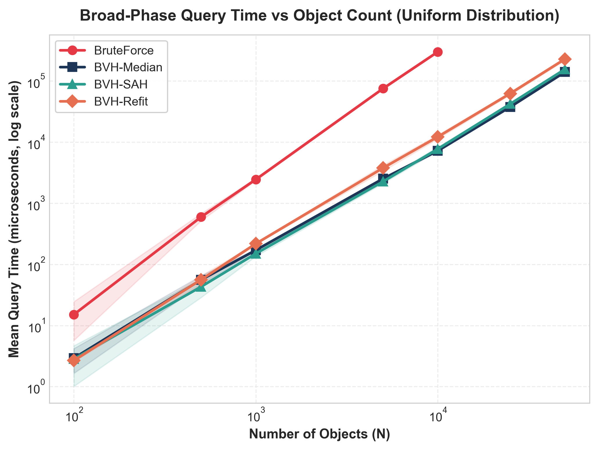
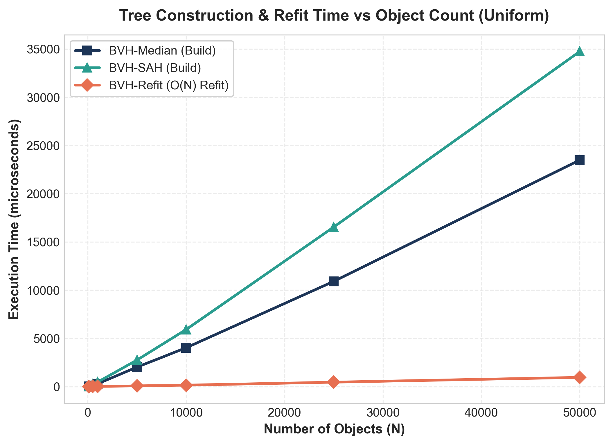
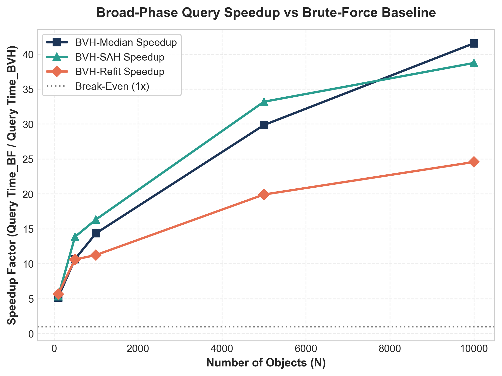
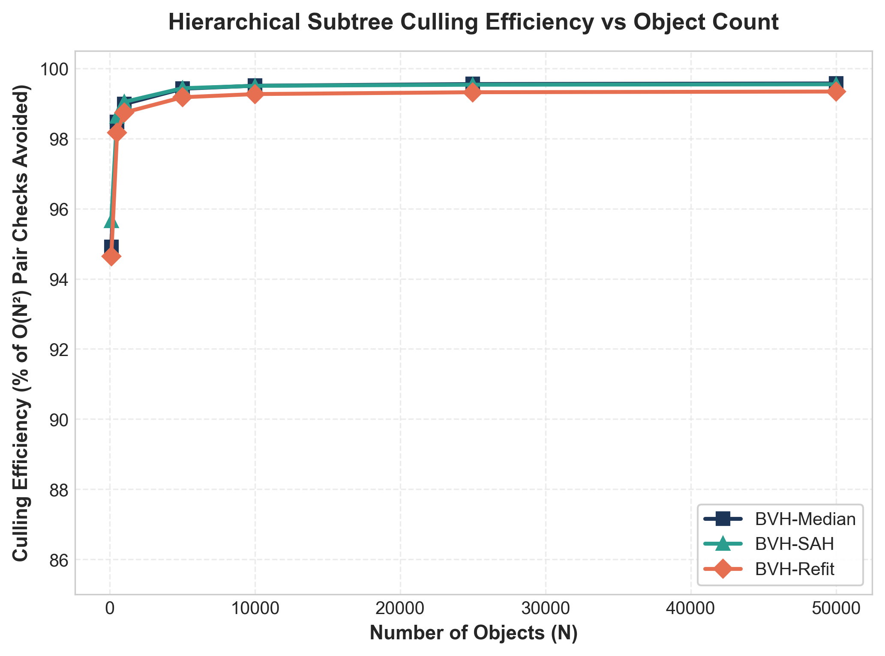
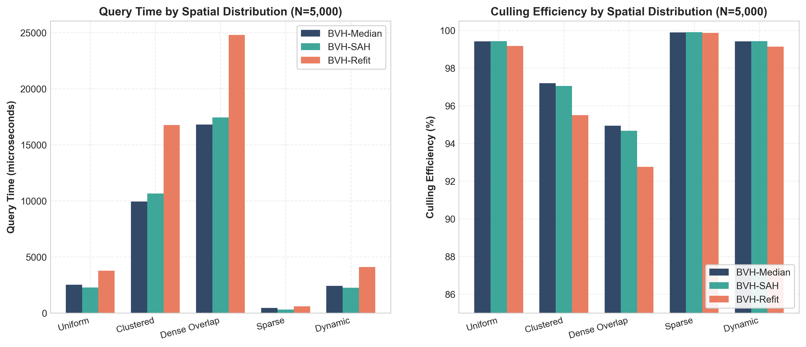
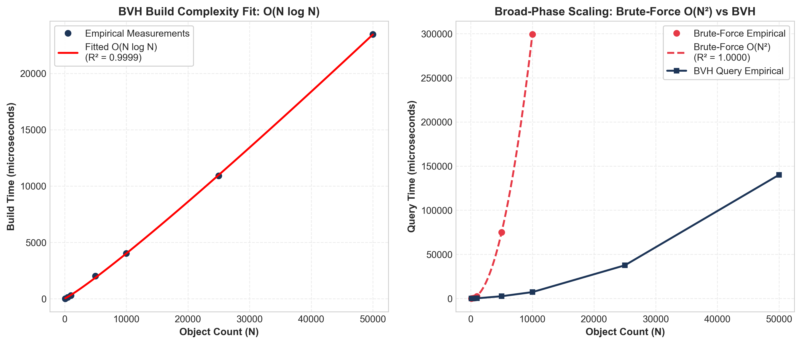

# Bounding Volume Hierarchy (BVH) & Contact Physics Simulation System
### High-Performance Spatial Partitioning & Collision Dynamics Suite (DSA Case Study)

[](https://en.cppreference.com/w/cpp/20)
[](#-contact-physics-engine)
[%20vs%20O(N%C2%B2)-cyan.svg)](#-complexity--empirical-performance-highlights)
[](#-reproducible-benchmarking-suite)
[](LICENSE)

An industrial-grade, portfolio-ready 2D collision detection and impulse physics engine showcasing **Bounding Volume Hierarchy (BVH)** spatial partitioning. It delivers **real-time spatial subdivision**, **hierarchical broad-phase subtree culling**, and **contact dynamics** in a native C++20 / SDL3 application, backed by a comprehensive **benchmarking suite** and **data analytics pipeline**.

---

## 🌟 Highlights & Key Features

- **Algorithmic Spatial Culling**: Cuts broad-phase collision tests from naive $O(N^2)$ down to $O(k + \log N)$ using hierarchical tree traversal.
- **Flat-Array Cache-Friendly Node Pool**: Nodes reside in a contiguous `std::vector<BVHNode>` indexed by 32-bit integer offsets, eliminating pointer chasing and allocation churn.
- **Multiple Partitioning Strategies**:
  - **Median-Split BVH**: Partitions object centroids along the longest bounding box axis ($O(N \log N)$ build).
  - **Surface Area Heuristic (SAH)**: 12-bin spatial heuristic minimizing expected query cost.
  - **Fat AABB Lazy Refit**: Inflated margins with bottom-up $O(N)$ tree refitting, rebuilding topology only when objects escape margins.
- **Contact Physics & Conservation Dynamics**:
  - Impulse-based momentum exchange with configurable restitution $e \in [0.0, 1.0]$ (Elastic, Inelastic, Partially Elastic).
  - Tangential Coulomb surface friction with static and dynamic impulse clamping.
  - Baumgarte positional de-penetration projection.
  - Quantitative conservation auditor computing Kinetic Energy ($\sum \frac{1}{2}mv^2$) and linear momentum.
- **Comprehensive Benchmarking & Analytics Harness**:
  - Standalone reproducible benchmarking CLI evaluating 7 scene sizes ($N=100$ to $50,000$), 5 spatial topologies, and 10 statistical repetitions.
  - Automated Python analytics producing 8 publication-grade charts (PNG & SVG) and summary reports.
  - Continuous bitwise correctness assertions verifying BVH candidate pairs against an exact brute-force baseline.

---

## ⚡ Complexity & Empirical Performance Highlights

All empirical figures below reflect physical measurements gathered over 10 repetitions with a high-resolution nanosecond clock on native Windows x86_64:

| Object Count ($N$) | Method | Build / Refit Time | Broad-Phase Query | Pairs Tested | Naive Pairs $O(N^2)$ | Culling Efficiency |
| :---: | :--- | :---: | :---: | :---: | :---: | :---: |
| **100** | BVH-Median | $7.51\,\mu\text{s}$ | $2.92\,\mu\text{s}$ | 252 | 4,950 | **$94.91\%$** |
| **500** | BVH-Median | $117.27\,\mu\text{s}$ | $55.89\,\mu\text{s}$ | 1,910 | 124,750 | **$98.47\%$** |
| **1,000** | BVH-Median | $290.47\,\mu\text{s}$ | $170.74\,\mu\text{s}$ | 5,082 | 499,500 | **$98.98\%$** |
| **5,000** | BVH-Median | $2,010.21\,\mu\text{s}$ | $2,514.43\,\mu\text{s}$ | 72,520 | 12,497,500 | **$99.42\%$** |
| **10,000** | BVH-Median | $4,022.18\,\mu\text{s}$ | $7,203.38\,\mu\text{s}$ | 247,534 | 49,995,000 | **$99.50\%$** |
| **10,000** | **Fat AABB Refit** | **$145.75\,\mu\text{s}$** | $12,186.62\,\mu\text{s}$ | 366,372 | 49,995,000 | **$99.27\%$** |
| **50,000** | BVH-Median | $23,476.11\,\mu\text{s}$ | $140,029.79\,\mu\text{s}$ | 5,382,303 | 1,249,975,000 | **$99.57\%$** |

> **Key Performance Takeaways**:
> - **41.5x Query Speedup** at $N=10,000$ compared to Brute Force ($7.20\text{ ms}$ vs $299.27\text{ ms}$).
> - **27.6x Refit Speedup** for Fat AABB refitting over full tree rebuilding ($145.75\,\mu\text{s}$ vs $4,022.18\,\mu\text{s}$).
> - **>99.5% Culling Efficiency** at scale, discarding over 1.24 billion unnecessary checks at $N=50,000$.
> - **Small-$N$ Break-Even ($N_{break}$)**: Total BVH step time (build + query) surpasses brute-force when $N \ge 120$–$150$.

---

## 📊 Visual Analytics & Performance Charts

The analytics pipeline generates publication-quality figures saved as both PNG and SVG in `analysis/figures/`:

| Query Scaling (Log-Log Scale) | Tree Build vs Object Count |
| :---: | :---: |
|  |  |
| *Log-log scaling: Brute force $O(N^2)$ vs BVH sub-linear* | *Median vs SAH vs O(N) Fat AABB Refit* |

| Speedup vs Brute Force | Subtree Culling Efficiency |
| :---: | :---: |
|  |  |
| *Speedup reaching >40x at N=10,000* | *Over 99.5% pair comparisons avoided* |

| Performance Across Distributions | Empirical Complexity Regression Fit |
| :---: | :---: |
|  |  |
| *Evaluation across 5 spatial distributions at N=5,000* | *Fitted $O(N \log N)$ ($R^2=0.9999$) and $O(N^2)$ ($R^2=1.0000$)* |

---

## 🏗️ Project Structure

```
BVH-Based-Collision-Detection-System/
├── CMakeLists.txt              # Primary CMake build configuration (SDL3 + native app)
├── vcpkg.json                  # SDL3 dependency pinning
├── requirements.txt            # Minimal Python dependencies for analytics pipeline
├── README.md                   # Project overview, architecture, and benchmark dashboard
├── LICENSE                     # MIT License
├── BENCHMARKS.md               # Visual simulation benchmark logs
├── EXPLANATION.md              # DSA case study breakdown
├── include/
│   └── logger.h                # High-performance zero-allocation logging utility
├── src/
│   ├── main.cpp                # SDL3 application window, event loop & render pipeline
│   ├── collision.h             # BVHNode, AABB, Pair, and partitioning interface
│   ├── collision.cpp           # Top-down construction, bottom-up refit & dual-tree traversal
│   ├── physics.h               # Impulse resolution, Coulomb friction & conservation auditor
│   └── physics.cpp             # Contact dynamics, de-penetration & Symplectic Euler kinematics
├── tests/
│   └── test_physics.cpp        # Unit test suite verifying physical conservation laws
├── benchmarks/                 # Isolated, reproducible benchmarking harness
│   ├── Makefile                # Cross-platform Makefile for benchmark suite
│   ├── run_benchmarks.ps1      # Single-command build & benchmark automation script
│   ├── include/
│   │   ├── benchmark_types.h   # Data structures, enums, and metric containers
│   │   ├── benchmark_utils.h   # O(N²) baseline, tree depth/memory analyzers, verification
│   │   └── scene_generator.h   # Synthetic scene generator (Uniform, Clustered, Dense, Sparse, Dynamic)
│   ├── src/
│   │   └── benchmark_runner.cpp# Standalone CLI harness executing benchmark grid
│   └── results/                # Output datasets
│       ├── benchmark_raw.csv   # Raw metrics for every individual trial run
│       ├── benchmark_summary.csv # Aggregated statistics (mean, median, std dev, min, max)
│       └── system_specs.json   # Machine environment specifications
├── analysis/                   # Data analytics & visualization suite
│   ├── generate_analytics.py   # Python plotting script (pandas + matplotlib + scipy)
│   ├── findings.md             # Plain-language empirical analysis & insights
│   ├── key_metrics_summary.csv # Tabular metrics across key configurations
│   ├── key_metrics_summary.md  # Formatted Markdown summary table
│   └── figures/                # Publication-quality charts (PNG and SVG formats)
└── docs/                       # Technical documentation & project reports
    ├── architecture.md         # Data layout, flat node pool, and Mermaid flowcharts
    ├── benchmark-report.md     # Academic-style benchmark methodology & evaluation
    ├── api-reference.md        # Comprehensive public API documentation
    └── CONTRIBUTING.md         # Guide for teammates on adding benchmark scenarios
```

---

## 🛠️ Building & Running

### 1. Interactive Graphical Simulation (SDL3)

Requires CMake 3.20+ and [vcpkg](https://github.com/microsoft/vcpkg) configured with `VCPKG_ROOT`.

```bash
# Configure via CMake with vcpkg toolchain
cmake -B build -S . -DCMAKE_TOOLCHAIN_FILE="${VCPKG_ROOT}/scripts/buildsystems/vcpkg.cmake"

# Build the release executable
cmake --build build --config Release

# Launch interactive simulation window
./build/Release/bvh_physics
```

#### Interactive Controls:
* `1` / `2` / `3`: Switch mode directly (`1` = BVH-Median, `2` = BVH-SAH, `3` = BVH-Refit).
* `B`: Cycle collision mode.
* `T`: Toggle hierarchical tree AABB debug visualizer overlay.
* `UP` / `DOWN`: Increase / decrease maximum tree depth drawn.
* `SPACE`: Pause / resume physical simulation.
* `R`: Reset scene with 500 new random circles.
* `E` / `I` / `P`: Switch restitution mode (`E` = Elastic $e=1.0$, `I` = Inelastic $e=0.0$, `P` = Partially Elastic $e=0.75$).
* `F` / `G`: Toggle Coulomb surface friction / gravity.
* `Left Click`: Spawn a circle at cursor.
* `Right Click + Drag`: Pull nearby circles toward cursor with force lines.
* `ESC`: Clean exit and flush logs.

---

### 2. Standalone Headless Benchmarks (`/benchmarks`)

The benchmarking suite has **zero external library dependencies** (pure C++20). It runs headlessly on any machine with a C++20 compiler:

```powershell
# Single-command build and execute (PowerShell)
powershell -ExecutionPolicy Bypass -File benchmarks/run_benchmarks.ps1

# Quick smoke test mode (N = 100, 500, 1000)
powershell -ExecutionPolicy Bypass -File benchmarks/run_benchmarks.ps1 -Quick
```

*Or via Make (Linux/macOS):*
```bash
make -C benchmarks run
```

---

### 3. Data Analytics Pipeline (`/analysis`)

Install minimal Python requirements and generate all figures and reports:

```bash
# Install dependencies
pip install -r requirements.txt

# Execute analytics pipeline
python analysis/generate_analytics.py
```

Outputs are automatically saved to `analysis/figures/`, `analysis/key_metrics_summary.md`, and `analysis/findings.md`.

---

## 📖 In-Depth Documentation

* **[Architecture & Memory Layout](docs/architecture.md)**: Detailed examination of the flat-array node pool, cache locality, and Mermaid traversal flowcharts.
* **[Benchmark Report](docs/benchmark-report.md)**: Academic-style technical report evaluating empirical scaling, statistical confidence, and limitations.
* **[Public API Reference](docs/api-reference.md)**: Signatures, complexity, parameters, and examples for all engine and benchmark functions.
* **[Contributing Guide](docs/CONTRIBUTING.md)**: Guide for teammates to add benchmark distributions and submit PRs.

---

## 📜 License

This project is licensed under the [MIT License](LICENSE).