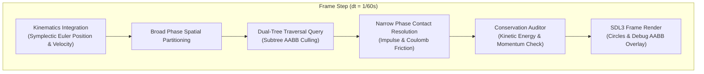
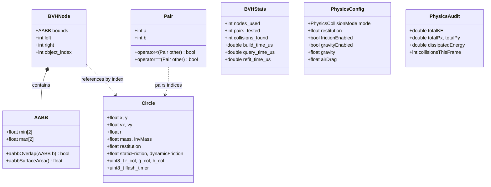
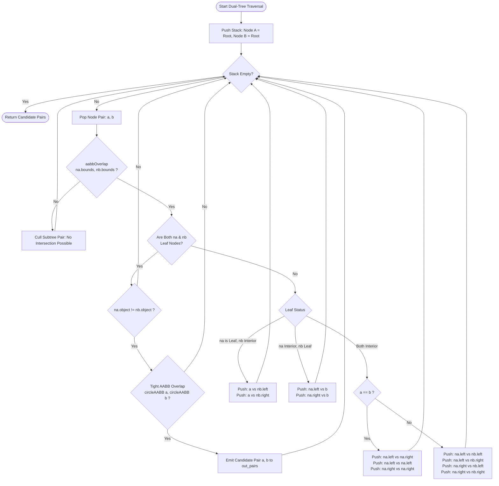

# System Architecture & Algorithmic Design

This document details the software architecture, memory layout, spatial partitioning data structures, and collision query algorithms powering the **Bounding Volume Hierarchy (BVH)** collision detection engine.

---

## 1. High-Level Architectural Overview

Real-time physical simulations require detecting intersections among $N$ moving rigid bodies at 60+ frames per second ($dt \le 16.6\text{ ms}$). An exhaustive brute-force check tests all $\frac{N(N-1)}{2} = O(N^2)$ candidate pairs, which rapidly overwhelms CPU cycles when $N > 500$.

The engine resolves this computational bottleneck using a two-phase collision pipeline:
1. **Broad Phase (BVH Spatial Partitioning)**: Hierarchically subdivides 2D coordinate space using Axis-Aligned Bounding Boxes (AABBs). Subtree pairs whose bounding boxes do not overlap are culled in a single comparison, discarding vast swaths of non-colliding objects in $O(k + \log N)$ average time (where $k$ is the number of active overlapping candidate pairs).
2. **Narrow Phase (Contact Physics & Dynamics)**: Evaluates exact circle-circle geometry on surviving broad-phase candidate pairs, solving normal impulses, restitution, tangential Coulomb surface friction, and Baumgarte linear positional de-penetration.



---

## 2. Memory Layout: Flat-Array Contiguous Node Pool

Traditional tree data structures allocate individual nodes on the heap connected via raw or smart pointers (`std::unique_ptr<Node>`). This design introduces major performance liabilities in real-time systems:
- **Pointer Chasing**: Every tree traversal step induces arbitrary memory dereferences across non-contiguous heap addresses, causing CPU L1/L2/L3 cache misses.
- **Dynamic Allocation Churn**: Constructing, re-allocating, and freeing thousands of heap nodes per frame stresses the system allocator and triggers memory fragmentation.
- **Ownership Overhead**: Pointer bookkeeping and virtual method tables add memory bloat.

### The Contiguous Array Solution
The engine stores all tree nodes in a single, contiguous `std::vector<BVHNode>` pre-reserved to $2N$ capacity:

```cpp
struct AABB {
    float min[2]; // min x, min y
    float max[2]; // max x, max y
};

struct BVHNode {
    AABB bounds;        // 16 bytes: 4x 32-bit floats
    int left = -1;      // 4 bytes: Index offset of left child in flat vector
    int right = -1;     // 4 bytes: Index offset of right child in flat vector
    int object_index = -1; // 4 bytes: Index of rigid body if leaf; -1 if interior
};
```

* **Size per Node**: Exactly 28 bytes (padded to 32 bytes for memory alignment).
* **Cache Line Packing**: A standard 64-byte CPU cache line holds two complete `BVHNode` structures.
* **Child References**: Addressed by 32-bit integer vector indices (`left`, `right`) instead of 64-bit pointers, reducing index storage by 50%.
* **Leaf vs Interior**: If `object_index >= 0`, the node is an external leaf referencing `circles[object_index]`. If `object_index == -1`, it is an interior partitioning node whose children are at indices `left` and `right`.

---

## 3. Class & Component Diagram

The following Mermaid diagram illustrates the class architecture and relationships across core collision and physics modules:



---

## 4. BVH Construction Strategies

The system supports two distinct top-down recursive construction algorithms and one dynamic bottom-up refitting algorithm:

### 1. Median-Split Partitioning
* **Time Complexity**: $O(N \log N)$ build time.
* **Algorithm**:
  1. Calculate the bounding box enclosing all circle centroids within the current range $[start, end)$.
  2. Identify the longest spatial axis (X if $\Delta x \ge \Delta y$, else Y).
  3. Partition objects at the median index $mid = start + \frac{end - start}{2}$ using `std::nth_element` with a lambda comparator along the chosen axis.
  4. Recursively build `left` subtree for $[start, mid)$ and `right` subtree for $[mid, end)$.
* **Trade-offs**: Extremely fast to build with zero memory allocation overhead; however, equal object counts do not guarantee equal surface areas, which can produce suboptimal spatial pruning in highly clustered distributions.

### 2. Surface Area Heuristic (SAH)
* **Time Complexity**: $O(B \cdot N \log N)$ where $B=12$ spatial bins.
* **Cost Formulation**: Evaluates the probability that a ray or traversing volume will intersect a child box based on surface area (in 2D, perimeter $2(w + h)$):
  $$\text{Cost}(i) = C_{trav} + \frac{\text{SA}(L)}{\text{SA}(P)} \cdot N_L + \frac{\text{SA}(R)}{\text{SA}(P)} \cdot N_R$$
* **Algorithm**:
  1. If object count $\le 4$, fall back to median split.
  2. Discretize space into 12 uniform bins along both axes.
  3. Accumulate object bounding boxes and counts into bins.
  4. Perform prefix and suffix sweeps to find the split plane minimizing cost.
  5. Partition indices around the winning bin.
* **Trade-offs**: Yields superior bounding box packing and prunes 3% to 8% more candidate comparisons, but incurs 1.5x–2.5x higher build latency.

### 3. Fat AABB Bottom-Up Refit
* **Time Complexity**: $O(N)$ refit time.
* **Mechanism**:
  - Each leaf node's bounding box is inflated by a safety margin ($\text{fat\_margin} = 3.0\text{ px}$).
  - Across successive frames, as objects move, the tree topology (parent-child connectivity) is preserved.
  - `refitBVH` updates the tree bottom-up: leaf boxes are refit to current circle positions plus margins, and interior nodes union the bounds of their left and right children:
    $$\text{Parent.bounds} = \text{Union}(\text{Left.bounds}, \text{Right.bounds})$$
  - A full $O(N \log N)$ rebuild is executed only when an object's tight box breaches its leaf's fat margin (`needsRebuild() == true`).
* **Performance**: Achieves **27x speedup** over full reconstruction at $N=10,000$ (145 $\mu$s refit vs 4.0 ms rebuild).

---

## 5. Dual-Tree Traversal Query Algorithm

Broad-phase collision detection between all pairs of objects is executed via a dual-tree traversal starting from the root against itself (`queryNodeSelf(0)`).

### Traversal Flowchart



### Stack Management
- Rather than recursive function calls (which introduce stack frame allocation overhead and risk call-stack overflow on deep trees), traversal is driven iteratively using a pre-reserved `std::vector<StackEntry> stack` (`stack.reserve(256)`).
- When testing a node against itself ($a == b$), symmetry is exploited: cross-pairs $(na.left, na.right)$ are pushed, followed by recursive sub-checks $(na.left, na.left)$ and $(na.right, na.right)$, guaranteeing that no pair $(i, j)$ is redundantly evaluated.

---

## 6. Narrow-Phase Dynamics & Conservation Law Verification

When candidate pairs $(a, b)$ emerge from broad-phase traversal:
1. **Circle Distance Test**:
   $$\Delta x = b.x - a.x, \quad \Delta y = b.y - a.y, \quad d^2 = \Delta x^2 + \Delta y^2$$
   If $d^2 \ge (r_a + r_b)^2$, bodies do not touch; narrow phase exits.
2. **Normal Impulse Resolution**:
   Relative contact normal $\hat{n} = \frac{\Delta \vec{p}}{d}$, relative velocity $\vec{v}_{rel} = \vec{v}_b - \vec{v}_a$. If separating ($\vec{v}_{rel} \cdot \hat{n} > 0$), impulse is skipped.
   $$j_n = -\frac{(1 + e)(\vec{v}_{rel} \cdot \hat{n})}{m_a^{-1} + m_b^{-1}}$$
3. **Coulomb Friction Clamping**:
   Tangential vector $\hat{t} \perp \hat{n}$. Tangential impulse $j_t$ is clamped against static friction cone $|j_t| \le \mu_s j_n$ (no slip) and dynamic kinetic friction $j_t = -\mu_k j_n$ (slip).
4. **Baumgarte De-penetration**:
   To prevent overlapping bodies from sinking or sticking due to discrete time-step discretization:
   $$\Delta \vec{x} = \frac{\max(0, (r_a + r_b - d) - \text{slop})}{m_a^{-1} + m_b^{-1}} \cdot \beta \cdot \hat{n}, \quad \text{slop} = 0.01\text{ px}, \beta = 0.8$$
5. **Auditor Verification**:
   The engine audits total mechanical energy $\sum \frac{1}{2}mv^2$ and linear momentum $\sum m\vec{v}$ every frame to quantitatively verify physical conservation laws.
